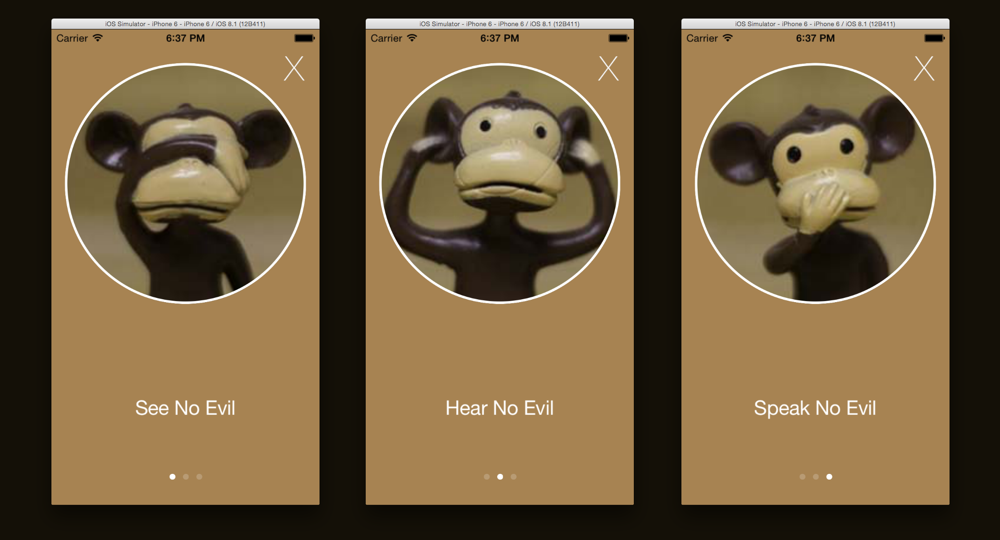
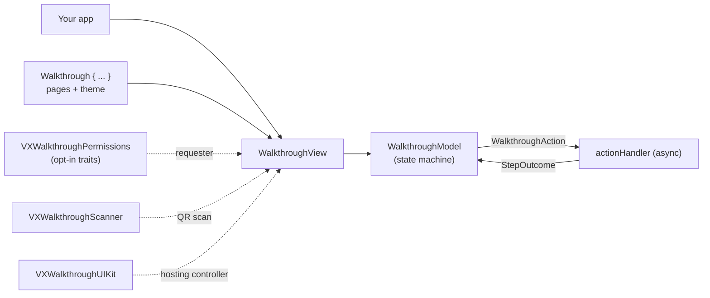

<div align="center">


# VXWalkthrough

**Declarative SwiftUI onboarding and walkthrough flows.**<br>
Info pages, login, input, permissions and your own custom pages, from one result-builder DSL.


[](https://github.com/swiftmanagementag/VXWalkthroughViewController-Swift/tags)
[](LICENSE)



</div>

---

> **Version 2** is a full rewrite for Swift 6 and SwiftUI. For the earlier
> UIKit/storyboard API see the `1.x` releases and the
> [migration guide](docs/migration-guide.md).

## ✨ Features

| | |
|---|---|
| 🧩 **Declarative DSL** | `Walkthrough { ... }` result builder, no storyboards, no dictionaries |
| 📄 **Page types** | info, input, login, signup, action, picker, permission, custom |
| 🔐 **Opt-in permissions** | notifications, camera, microphone, photos, location, contacts, tracking, each behind a SwiftPM trait |
| 🔌 **Host-extensible** | inject your own SwiftUI pages with `CustomPage` |
| ⚡ **async/await actions** | a typed `StepOutcome` state machine |
| 🎨 **Themeable** | page, button, indicator and nav theming, per-step overrides, optional iOS 26 Liquid Glass chrome |
| ♿ **Accessible** | Dynamic Type, VoiceOver labels, reduce motion, stable accessibility identifiers |
| 📷 **Optional extras** | QR/barcode scanning and UIKit interop as separate products |
| 📦 **No required dependencies** | the core links no privacy-sensitive frameworks |

## 🏗️ How it fits together



## 📋 Requirements

| | |
|---|---|
| Platforms | iOS 17+, iPadOS 17+, Mac Catalyst 17+ (macOS 14+ builds the core for `swift test` and CI) |
| Toolchain | Swift 6.1+ tools (package traits), Xcode 26 |

## 📦 Installation

Swift Package Manager:

```swift
.package(url: "https://github.com/swiftmanagementag/VXWalkthroughViewController-Swift", from: "2.3.0")
```

| Product | Purpose |
|---|---|
| `VXWalkthrough` | the core SwiftUI framework, references **no** privacy-sensitive frameworks |
| `VXWalkthroughPermissions` | optional, opt-in system permission backends (see [Permissions](#permissions-opt-in)) |
| `VXWalkthroughScanner` | optional QR/barcode scanning |
| `VXWalkthroughUIKit` | optional `UIHostingController` convenience |

## 🚀 Usage

```swift
import SwiftUI
import VXWalkthrough

struct OnboardingView: View {
    @Binding var isPresented: Bool

    var body: some View {
        WalkthroughView(
            Walkthrough(theme: .default) {
                InfoPage("welcome", title: "See *No* Evil", image: .named("walkthrough_0"))
                InfoPage("hear", title: "Hear No Evil", image: .named("walkthrough_1"))

                LoginPage(loginPrompt: "Email", passwordPrompt: "Password", scanEnabled: true)

                PermissionPage(.notifications, rationale: "Stay up to date")

                ActionPage("done", title: "You're all set!", buttonTitle: "Get Started")
            }
        )
        .actionHandler { action in
            switch action.payload {
            case let .login(creds):
                do { try await api.signIn(creds); return .success("Welcome back!") }
                catch { return .failure("Could not sign in") }
            default:
                return .advance
            }
        }
        .onFinish { isPresented = false }
    }
}
```

### Show it once per app version

```swift
let gate = WalkthroughPresentationGate()
if gate.shouldPresent {
    showOnboarding = true
    gate.setShown()
}
```

### Permissions (opt-in)

System permission backends are **opt-in** so the core product links no
privacy-sensitive frameworks — apps that don't request permissions are never
forced to declare unused purpose strings. To request real permissions:

1. Enable the **traits** you need on the package dependency (each trait links
   only its framework):

```swift
.package(
    url: "https://github.com/swiftmanagementag/VXWalkthroughViewController-Swift",
    .upToNextMajor(from: "2.3.0"),
    traits: ["PermissionsNotifications", "PermissionsCamera"]
)
```

   Available traits (default: none): `PermissionsNotifications`,
   `PermissionsCamera`, `PermissionsMicrophone`, `PermissionsPhotos`,
   `PermissionsLocation`, `PermissionsContacts`, `PermissionsTracking`.

2. Add the `VXWalkthroughPermissions` product to your target and inject the
   system requester:

```swift
import VXWalkthroughPermissions

WalkthroughView(walkthrough)            // contains a PermissionPage
    .walkthroughPermissionRequester(SystemPermissionRequester())
```

3. Add the matching `NS…UsageDescription` keys to your `Info.plist` **only for
   the traits you enable**.

Without an injected requester (or for a kind whose trait is disabled), a
`PermissionPage` resolves to `.advance` and skips itself — so the flow still
works, it just doesn't prompt. You can also supply your own requester
conforming to `PermissionRequesting` (e.g. to add logging) without the
permissions product at all.

### QR scanning

```swift
import VXWalkthroughScanner

WalkthroughView(walkthrough)   // a LoginPage with scanEnabled: true
    .walkthroughQRScanner()
```

On capable devices this uses VisionKit's `DataScannerViewController`, falling
back automatically to an AVFoundation scanner on Mac Catalyst or older hardware.
Voucher URLs are parsed as before (the `voucher` query item becomes the value).

### UIKit hosts

```swift
import VXWalkthroughUIKit

let vc = WalkthroughHostingController(walkthrough)
present(vc, animated: true)
```

### Custom pages

```swift
Walkthrough { CustomPage("promo") }

WalkthroughView(walkthrough)
    .walkthroughCustomPage("promo") { proxy in
        MyPromoView(onContinue: proxy.advance)
    }
```

### Localized auto-population (parity with 1.x)

Define `walkthrough_0`, `walkthrough_1`, … in your string catalog and:

```swift
let walkthrough = Walkthrough(steps: LocalizedStepsLoader().load())
```

### Images (asset catalog or loose files)

`.named("…")` resolves from an asset catalog **or** loose `.png`/`.jpg`/`.jpeg`
files — handy for legacy projects whose `walkthrough_0…n` art ships as loose
files. The host app bundle is searched before the library bundle, so loose
images in your main bundle are found with no configuration. To point at a
custom resource bundle:

```swift
WalkthroughView(walkthrough)
    .walkthroughImageBundle(.myResources)
```

Set the image style on your `WalkthroughTheme`. Use `.fit` for wide artwork that
should be shown in full (aspect-fit, no cropping, with rounded corners):

```swift
WalkthroughTheme(imageStyle: .fit)   // or .round (default) / .card / .fullBleed
```

### Circular images (`.round`)

`.round` (the default) renders the illustration in a circle. The diameter is
resolved automatically to the **largest circle that fits across every page**
(leaving a margin), and recalculated on rotation, iPad multitasking, and Mac
Catalyst window resizing. Tune it via `CircleStyle`:

```swift
WalkthroughTheme(
    imageStyle: .round,
    circleStyle: .init(
        maxDiameter: 320,    // cap; pass nil to grow to the available space
        margin: 24,          // breathing room kept around the circle
        borderWidth: 3,
        borderColor: .white,
        showsShadow: true
    )
)
```

### Branding: buttons, indicators, and nav controls

For a branded (non-white) background, theme the CTA, page-control dots, and the
Next / Previous / Close controls so they keep adequate contrast. Everything is
optional and defaults to the prior look (button filled with `accent` + white
label; dots and nav derived from `titleColor`):

```swift
WalkthroughTheme(
    background: brandCyan,
    titleColor: .black,
    bodyColor: .black.opacity(0.8),
    actionButtonStyle: .init(
        background: .black,        // CTA fill
        foreground: .white,        // CTA label
        cornerStyle: .capsule      // or .radius(16)
    ),
    pageIndicatorColor: .black.opacity(0.3),
    pageIndicatorSelectedColor: .black,
    navControlTint: .black
)
```

An `ActionPage` can also carry a per-step `buttonStyle:` to override the theme
for a single CTA.

### Login fields and scanning

`LoginPage` supports per-field placeholders, per-field secure entry, and a
labelled scan button — useful for B2B "email + code" logins:

```swift
LoginPage(
    loginPrompt: "Email",
    passwordPrompt: "Voucher code",
    loginPlaceholder: "info@domain.com",
    passwordPlaceholder: "xxxx-xxxx-xxxx",
    passwordSecure: false,         // a short human-entered code isn't masked
    scanEnabled: true,
    scanTitle: "Scan voucher"      // visible label instead of an icon-only button
)
```

### Optional second action on the login page

`LoginSpec.secondaryTitle` adds a text button **below** the sign-in row, for a
second route to the same outcome (for example "Buy instead"). It is `nil` by
default, so existing login pages are unchanged. Tapping it reports a
`.action` payload (the primary button reports `.login`). The `LoginPage` DSL
shortcut does not expose it yet; build the step from a `LoginSpec`:

```swift
let login = WalkthroughStep(
    id: "login",
    kind: .login(LoginSpec(buttonTitle: "Sign In", secondaryTitle: "Buy instead"))
)

WalkthroughView(Walkthrough(steps: [login]))
    .actionHandler { action in
        switch action.payload {
        case .login(let credentials):
            return await signIn(credentials)   // your sign-in call
        case .action:
            return .advance                    // the second action was tapped
        default:
            return .advance
        }
    }
```

> Available on `master` after the 2.3.0 tag; it ships with the next release.

### Per-step theme override

Any page accepts an optional `theme:` to diverge for a single step (e.g. a
high-contrast CTA), without changing the global theme:

```swift
ActionPage("cta", title: "Ready?", buttonTitle: "Let's go",
           theme: WalkthroughTheme(background: .black, titleColor: .white))
```

### Driving navigation from a custom page

A `CustomPage` view can advance the walkthrough itself via the environment:

```swift
struct ExamDatePage: View {
    @Environment(\.walkthroughAdvance) private var advance
    var body: some View {
        Button("Continue") { advance() }   // or advance.finish()
    }
}
```

## 📚 Documentation

- [Changelog](CHANGELOG.md)
- [Migration guide (1.x to 2.0)](docs/migration-guide.md)
- [Modernization plan](docs/ios26-refactor-plan.md)
- A runnable example lives in [`Demo/`](Demo/).
- DocC: build documentation for the `VXWalkthrough` scheme in Xcode.

## 🙏 Credits

VXWalkthrough is brought to you by
[Swift Management AG](https://www.swiftmanagement.ch) and contributors. The
original UIKit implementation was based on Yari D'areglia's BWWalkthrough and
Sam Vermette's SVWebViewController.

## 📄 License

VXWalkthrough is released under the MIT License. See [LICENSE](LICENSE) for the
full text.
